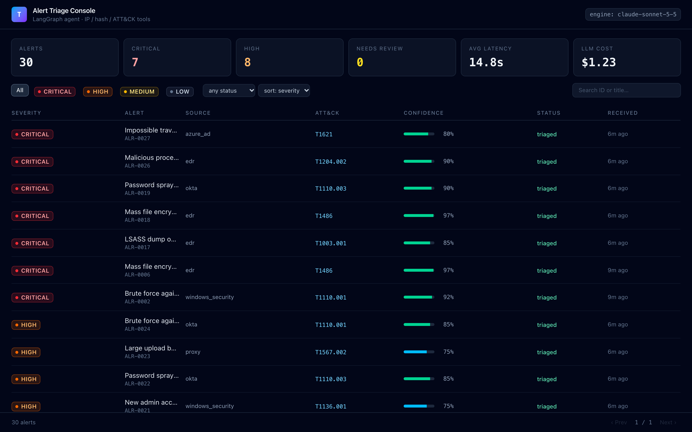
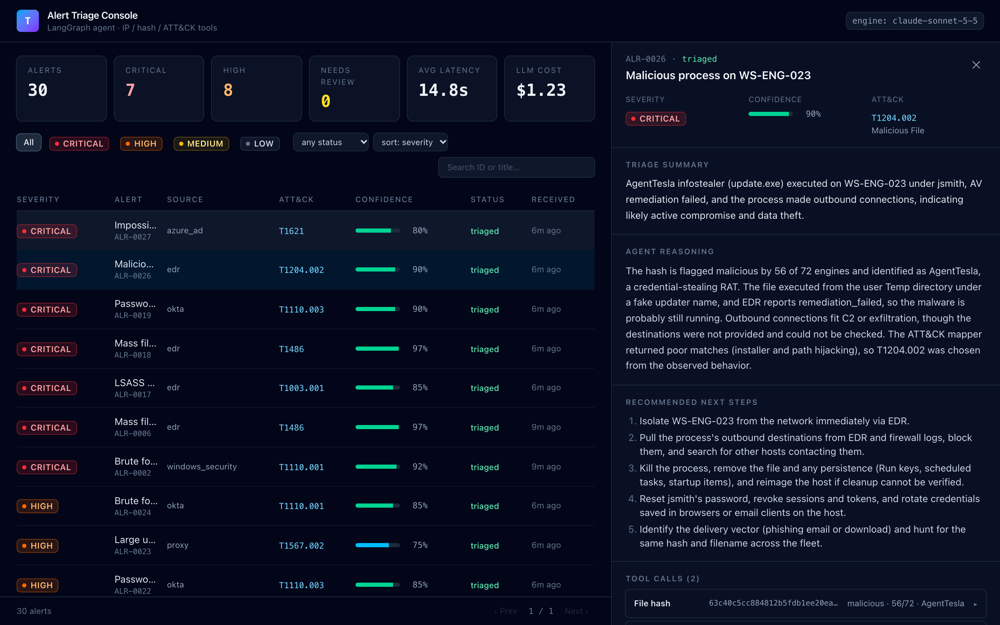
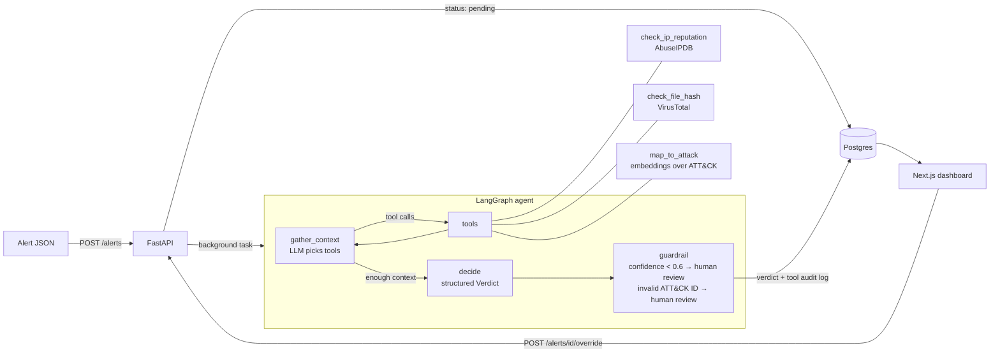

# AI Security-Alert Triage Agent

A LangGraph agent that triages security alerts the way a tier-1 SOC analyst would. It reads an
alert, pulls context from threat-intel tools (IP reputation, file-hash reputation, and a MITRE
ATT&CK mapper built on vector embeddings), decides a severity, and writes a short triage report
with next steps. Low-confidence verdicts go to a human instead of being auto-closed. A Next.js
dashboard shows every decision with the agent's reasoning and the exact tool calls it made, and
an evaluation suite of 206 labeled alerts (including real attack telemetry from OTRF) measures
how often it's right, tracked across prompt and model changes.





## Architecture



| Layer | Tech |
|---|---|
| Agent | LangGraph, Claude via `langchain-anthropic`, `with_structured_output(Verdict)` |
| Tools | AbuseIPDB, VirusTotal (cached in Postgres), MITRE ATT&CK STIX data + sentence-transformers (TF-IDF fallback) |
| API | FastAPI, SQLAlchemy 2, PostgreSQL |
| Dashboard | Next.js 16, React 19, Tailwind 4 |
| Evals | 206 labeled alerts, confusion matrix, missed-critical tracking, run history |
| Infra | Docker Compose, GitHub Actions, Render blueprint |

## Evaluation

`python -m evals.run_evals` runs every labeled alert through the agent and writes
[`backend/evals/results.md`](backend/evals/results.md): severity accuracy, a confusion matrix,
ATT&CK technique accuracy, missed critical alerts (the number that matters most), how often the
guardrail flags for review and whether flagged verdicts really are less accurate, plus latency
and cost per alert. Each run is appended to a history table with the prompt version, so you can
see whether a prompt or model change helped.

Threat intel is pinned to fixtures during evals, so a score change means the agent changed, not
the outside world.

| Engine | Severity accuracy | ATT&CK accuracy | Missed critical | Avg cost / alert |
|---|---|---|---|---|
| Rules baseline (keyword + intel, no LLM) | 64.6% | 80.1% | 9 / 45 | $0 |
| LLM agent (`claude-sonnet-5-5`) | 94.7% | 98.5% | 5 / 45 | $0.041 |

What the first full run (206 alerts) shows. Full breakdown in
[`results.md`](backend/evals/results.md).

- **Every mistake is off by one level, and only between high and critical.** Low and medium are
  100% correct, and no critical alert was called low or medium (0 silent misses).
- **All 5 missed criticals are the same pattern:** Word spawning hidden, encoded PowerShell that
  downloads a script from a known-malicious IP. The agent gets the technique right (T1059.001)
  but calls it high because "the payload isn't confirmed to have run", while the rubric treats a
  malicious document executing as critical. This makes PowerShell the weakest scenario (68.8%)
  and the clearest target for the next prompt change.
- **Most false criticals are impossible travel:** 4 of 6 are impossible-travel alerts (T1078)
  escalated from high to critical, which makes it the second-weakest scenario at 71.4%.
- **The confidence guardrail doesn't catch these mistakes yet.** All 11 wrong verdicts had
  confidence 0.70–0.85, above the 0.6 review threshold, so only 0.5% of alerts were sent to a
  human. Confidence is not yet calibrated well enough to route the borderline high/critical calls.
- **Versus the rules baseline:** +30 points severity accuracy, +18 points ATT&CK accuracy, 4 fewer
  missed criticals, and the review queue drops from 86% of alerts to under 1%.
- **Cost and speed:** $0.041 per alert (about 9k tokens, 1.4 tool calls), 11.6s average, 15.1s p95.

**About the labels:** labels were proposed by the scenario generator, then reviewed by hand
(`python backend/scripts/review_labels.py`; every label carries `"reviewed": true`). The agent and
the labels share one written severity rubric, the way a SOC grades analysts against its policy.
See [`backend/evals/LABELING.md`](backend/evals/LABELING.md).

## The dataset

- **200 synthetic alerts** from `scripts/generate_alerts.py`, across 17 scenarios: brute force,
  password spray, impossible travel, encoded PowerShell, known-bad hashes, port scans, LSASS
  dumping, ransomware, rogue admin accounts, scheduled-task persistence, cloud exfiltration, C2
  beaconing, external RDP, web exploits, UAC bypass, MFA fatigue, and plenty of benign noise.
  Many scenarios have a benign twin (SCCM PowerShell, Defender reading LSASS, the authorized
  vulnerability scanner, the EICAR test file) so the agent has to read context, not keywords.
- **6 real alerts** from [OTRF Security-Datasets](https://github.com/OTRF/Security-Datasets)
  (`scripts/import_otrf.py`): Sysmon events recorded while Mimikatz, comsvcs MiniDump, ntdsutil,
  esentutl and an Empire stager ran in a lab.
- **706 ATT&CK techniques** from [mitre/cti](https://github.com/mitre/cti)
  (`scripts/build_attack_data.py`).

## Quick start (Docker)

```bash
cp .env.example .env          # add ANTHROPIC_API_KEY (optional: AbuseIPDB / VirusTotal keys)
docker compose up --build     # API on :8000, dashboard on :3000, Postgres on :5432
python backend/scripts/seed.py --limit 30   # send some alerts; the agent triages them
```

Open http://localhost:3000. API docs are at http://localhost:8000/docs.

Without an `ANTHROPIC_API_KEY` the API uses the rules baseline, so the whole stack still runs.
Without intel keys the tools read `data/intel_fixtures.json`. Build a smaller image without the
local embedding model with `WITH_EMBEDDINGS=false docker compose up --build`.

## Local development

```bash
cd backend
python -m venv .venv && source .venv/bin/activate
pip install -r requirements-dev.txt
pip install torch --index-url https://download.pytorch.org/whl/cpu && pip install -r requirements-embeddings.txt  # optional
uvicorn app.main:app --reload       # uses SQLite unless DATABASE_URL is set
pytest -q                           # 35 tests: tools with mocked APIs, agent with a scripted LLM, API, metrics

python -m evals.run_evals --engine baseline        # no key needed
python -m evals.run_evals --limit 20               # LLM agent, quick check
python -m evals.run_evals --note "tightened rubric" # full run, saved to history

cd ../frontend && npm install && npm run dev       # http://localhost:3000
```

## API

| Method | Path | Purpose |
|---|---|---|
| `POST` | `/alerts` | Store an alert (status `pending`) and triage it in the background. `?sync=true` waits. |
| `GET` | `/alerts` | List with latest verdict. Filters: `severity`, `status`, `needs_review`, `q`; `sort=severity\|received` |
| `GET` | `/alerts/{id}` | Alert, verdict, reasoning, tool-call audit log, overrides |
| `POST` | `/alerts/{id}/override` | Analyst correction (severity, technique, note) |
| `POST` | `/alerts/{id}/retriage` | Run the agent again |
| `GET` | `/overrides/export` | Corrections in eval-label format, to grow the eval set |
| `GET` | `/stats` | Counts, review queue size, latency, total LLM cost |

Tables: `alerts`, `verdicts`, `tool_calls` (audit log), `overrides`, `intel_cache`.

## Design decisions

- **Structured output, then a guardrail node.** The verdict is a Pydantic model, so the output is
  always valid JSON. A separate guardrail node flags anything under 0.6 confidence, or with an
  ATT&CK ID that doesn't exist, for a human. The eval reports accuracy on flagged versus
  auto-handled alerts to check that confidence is actually calibrated.
- **Every tool call is audited** with arguments, output and latency, and shown in the dashboard.
- **Missed critical alerts get their own metric**, including "silent misses" (critical alerts
  called low/medium and not flagged), because that's the failure that hurts in a SOC.
- **Human overrides become eval data** via `/overrides/export`.
- **Free-tier friendly:** intel lookups are cached in Postgres, private IPs skip the API, and
  rate-limit responses come back to the agent as "unknown" instead of crashing it.

## Deploy

`render.yaml` is a Render Blueprint for the API, dashboard and a free Postgres. In Render: New →
Blueprint → this repo, then fill in the secrets it asks for. Set `NEXT_PUBLIC_API_URL` on the web
service to the API's URL and `CORS_ORIGINS` on the API to the dashboard's URL. The free plan's
512 MB RAM means the API builds without torch and uses the TF-IDF mapper. Render's free Postgres
expires after 30 days.

## Optional: LangSmith tracing

Set `LANGSMITH_TRACING=true` and `LANGSMITH_API_KEY` in `.env`. LangGraph traces every run
automatically, so you can show the full tool-calling trace for any alert.

## Project layout

```
backend/
  agent/      graph.py (LangGraph), prompts.py (rubric), baseline.py, runner.py
  tools/      intel.py (AbuseIPDB, VirusTotal, cache), attack_mapper.py (embeddings)
  app/        FastAPI app, SQLAlchemy models, service layer
  evals/      run_evals.py, metrics.py, report.py, labels.json, results.md, history.jsonl
  data/       alerts.json, intel_fixtures.json, attack_techniques.json
  scripts/    generate_alerts.py, import_otrf.py, build_attack_data.py, review_labels.py, seed.py
  tests/
frontend/     Next.js dashboard
```
